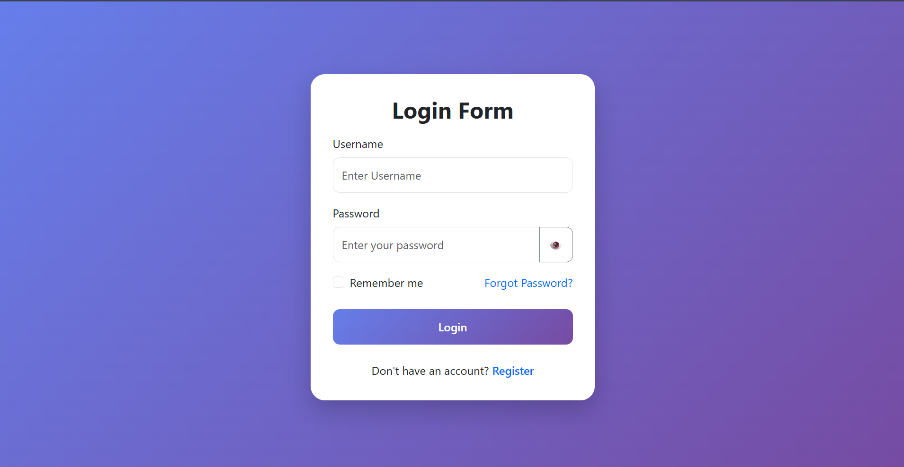
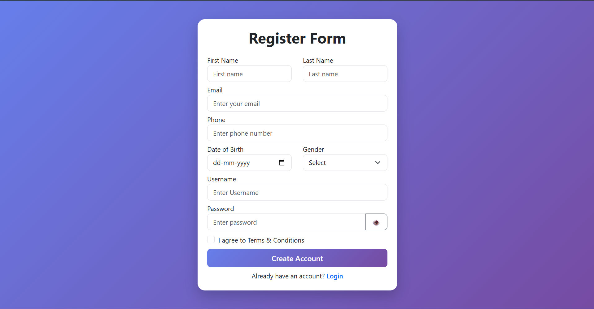
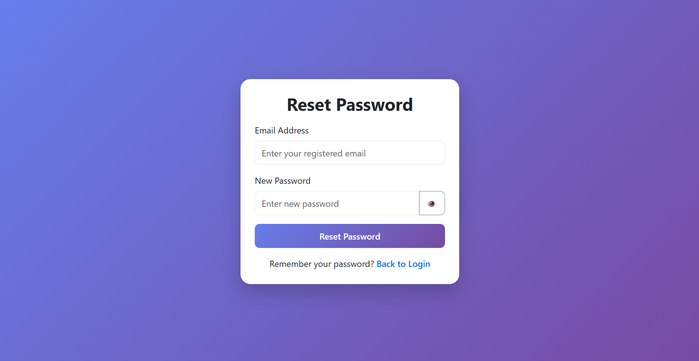
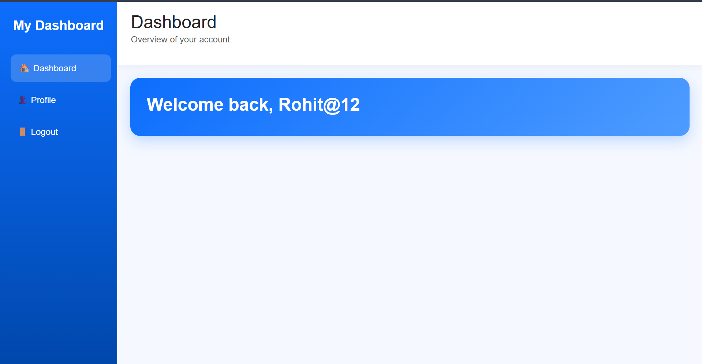
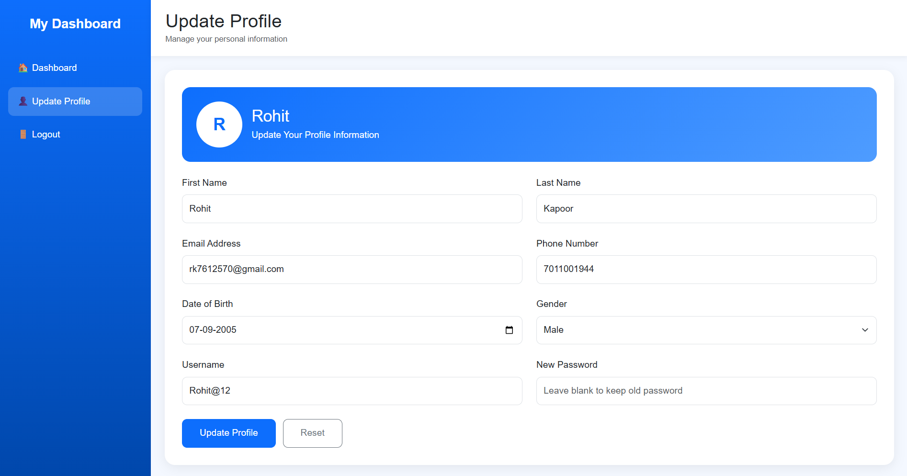
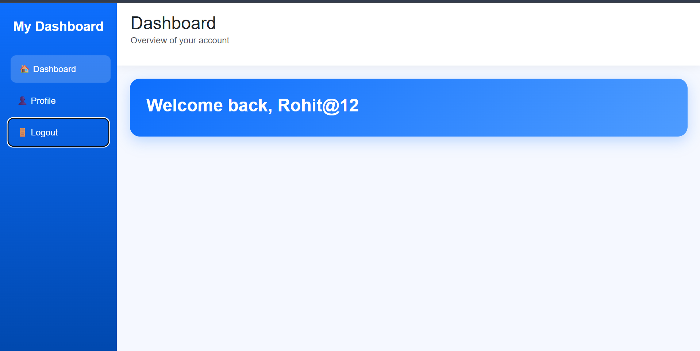

#  Login & User Dashboard System

A simple and responsive **PHP Login and User Dashboard System** built using PHP, MySQL, HTML, CSS, Bootstrap, and JavaScript.

This project is created  user  Basic authentication, database connectivity, password hashing, sessions, cookies, profile management as to Edit Details  and basic CRUD operations.

let See this https://login-user-dashboard-system.onrender.com

## 🚀 Features

- ✅ User Registration
- ✅ User Login
- ✅ Password Hashing
- ✅ Password Verification
- ✅ Forgot Password
- ✅ PHP Session Authentication
- ✅ PHP Cookies
- ✅ Protected Dashboard
- ✅ Update Personal Information
- ✅ Logout

---

## 🛠️ Technologies Used

- HTML5 & CSS
- Bootstrap 5
- JavaScript Basic  
- PHP
- MySQL (Database)
- XAMPP (Xampp is provide a Server)

## 📂 Project Structure

PHP-Login-Authentication-System/
│
├── login.php
├── register.php
├── forget.php
├── update.php
├── dash.php
├── logout.php

<h1>Login Form </h1>

<h1>Register Form </h1>

<h1>Reset Password </h1>

<h1>Dashboard Page</h1>

<h1>Update Profile Page </h1>

<h1>Logout  </h1>

